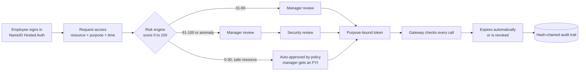

# ASTITVA Handbook

**Purpose-bound, time-boxed, fully audited access to your AI models, datasets and databases.**

ASTITVA is an access-governance service for companies that run sensitive AI models and data. Nobody holds standing
access. Every person asks for exactly what they need, for a stated purpose and a fixed time. The right people approve
it, the access expires on its own, and every step lands in a tamper-evident audit trail.

This handbook explains how the service works for a customer organisation: how a new employee is onboarded, what each
role does day to day, how one access request travels from "I need this" to "access revoked", how the platform protects
itself, and how it is deployed.

> **Simulated demo tenant.** The handbook uses the fictional company **Nexora Technologies**. Every person, resource,
> token and dataset in it is made up, and nothing connects to a real production system.

**Live demo:** <https://astitva-gray.vercel.app> · **Source:** <https://github.com/Shreyansh00Tech/astitva>

---

## Contents

1. [Why ASTITVA](#1-why-astitva)
2. [The service at a glance](#2-the-service-at-a-glance)
3. [Onboarding a new employee](#3-onboarding-a-new-employee)
4. [Roles and what each one does](#4-roles-and-what-each-one-does)
5. [The access lifecycle: request, approve, use, expire, revoke](#5-the-access-lifecycle)
6. [Security model](#6-security-model)
7. [Deployment and operations](#7-deployment-and-operations)
8. [Try it in five minutes](#8-try-it-in-five-minutes)
9. [Service guarantees and current limits](#9-service-guarantees-and-current-limits)
10. [Further reading](#10-further-reading)

---

## 1. Why ASTITVA

AI teams move fast, and access usually moves faster than governance. A data scientist gets "temporary" write access to
a production model, the project ends, and the access stays for a year. An AI agent built for support quietly gains a
path to the finance ledger. Nobody can say who approved what, or why.

ASTITVA replaces that with four rules that the server enforces on every call:

| Rule | What it means in practice |
|---|---|
| **Least privilege by default** | Each purpose (for example *Model testing*) comes with the smallest permission set it needs. Asking for more raises the risk score. |
| **Every grant has an end** | Access expires automatically, and never outlives the employee's project. Extending it means a new request, never a silent extension. |
| **Nobody approves themselves** | Separation-of-duties checks run at every approval stage, under every role. |
| **Everything is evidence** | Each security action is written to a SHA-256 hash-chained audit log that anyone with audit rights can verify. |

AI helps, but it never decides. The risk engine recommends and explains; grants come only from deterministic policy plus
human approval.

## 2. The service at a glance



What the customer gets:

- **Access requests and approvals** with risk-based routing, narrowing, and a priority queue for approvers.
- **Short-lived, purpose-bound tokens** checked by a gateway on each call to a model, dataset or database.
- **Automatic expiry**, tied to both the requested duration and the employee's project end date.
- **Revocation in one click**: whole grant or single permissions, with a reason and a notice to the employee.
- **Access dependency graph**: see everyone and everything (people, AI agents, downstream APIs) that would be affected
  before you cut access to a model.
- **AI agent governance**: agents have their own keys, approved tools and resources, and are blocked at an agent gateway.
- **Emergency (break-glass) access** that is capped, alarmed, monitored and reviewed afterwards.
- **Drift detection and recertification** campaigns so access that is no longer needed is found and removed.
- **Security alerts and a verifiable audit trail**, exportable to CSV.

## 3. Onboarding a new employee

This is the journey when a new person joins a customer company that uses ASTITVA. Using the demo tenant, imagine
**Kavya Reddy** joining Nexora as an HR Generalist.

### Step 1. The administrator adds the person in NamoID

The company's identity administrator creates Kavya in the **NamoID Console** (the company's identity provider) and
assigns her ASTITVA role: `requester`. Her manager, Priya, already has `manager`.

ASTITVA reads roles from NamoID at every sign-in, so the identity provider stays the single place where people and roles
are managed. Role changes are written to ASTITVA's audit trail automatically.

### Step 2. First sign-in

Kavya opens ASTITVA and clicks **Continue with NamoID**. She signs in on NamoID's hosted page, and is sent back to
ASTITVA. On that first sign-in ASTITVA:

1. verifies the NamoID ID token (signature, issuer, audience, expiry, nonce, state, PKCE);
2. requires a verified email;
3. creates her ASTITVA account and links it to her department, manager and current project;
4. maps her NamoID role to ASTITVA permissions;
5. issues its own HttpOnly session cookies. NamoID tokens never reach the browser.

If NamoID sends no role, a new user starts as an Employee (requester) with no access at all.

### Step 3. Day one: zero standing access

Kavya's dashboard is empty on purpose. She has **no grants** until she asks for one. Her **Overview** page shows:

- her current project, its due date and her team;
- a single timeline with the project start, submission and end dates, and each grant's start and expiry.

### Step 4. Her first request

Kavya needs the HR Employee Database for payroll. She opens **Request access**, picks the resource, the purpose
*Payroll processing*, READ only, and 3 days, and writes a short justification. Because the database is RESTRICTED, a
human must approve it no matter how low the score is, so it goes to Priya. Once Priya approves, Kavya gets a token and
can use the resource through the gateway. When the 3 days are over, the access ends on its own.

### When people move or leave

| Event | What ASTITVA does |
|---|---|
| **Mover** (department transfer) | Access reviews are created automatically so the new manager confirms or removes old access. |
| **Leaver** (deactivation) | All grants, tokens and sessions are revoked in one transaction. |
| **Project ends** | No grant can outlive the project end date. Ask for 30 days with 15 days left on the project, and access ends in 15. |

## 4. Roles and what each one does

ASTITVA uses five roles. They come from NamoID with these exact names: `requester`, `manager`, `risk_reviewer`,
`resource_owner` and `security_manager`. The server is the only source of truth for what each role can do; the UI just
hides what you cannot use, and the API returns 403 regardless.

### Requester (employee)

*In the demo: Rahul Sharma (Engineering), Neha Gupta (Finance), Kavya Reddy (HR).*

- Requests access: resource, purpose, permissions, duration, justification, plus an optional deadline and business
  impact that set the review priority.
- Tracks requests and sees **why** each one took its approval path.
- Reveals and uses tokens for approved, active grants.
- Requests emergency (break-glass) access for an incident.
- Chats 1:1 with their manager in **Messages**.
- **Cannot** approve anything, and **cannot** change or extend their own grants.

### Manager

*In the demo: Priya Desai, manager of all three employees.*

- First approver for the team's medium and high risk requests. Gets an FYI for every auto-approved one.
- Can approve, reject, **narrow** (drop permissions or shorten time) or send a request back for changes.
- Sees the team's active access and can **revoke** a grant or remove single permissions, with a reason.
- Uses the **Access dependency graph** for the team's grants, and runs access reviews (recertification).
- Sees team analytics built only from verified task events, never self-reported data.

### Risk reviewer

*In the demo: Meera Krishnan holds this role together with Security Manager.*

- Performs the **security review**, the second stage for high-risk (61+) or anomaly-flagged requests, using the risk
  assessment and its plain-language explanation.
- Sees all requests, security alerts, drift findings and the audit trail.
- Monitors emergency access sessions.

### Resource owner

- An optional role for the person accountable for a specific model, dataset or database.
- Can approve requests for resources they own, manage those resources, revoke grants on them and act on drift findings.
- In the default demo setup there is no separate owner stage in the approval path: the owner of each resource is shown
  for information. A customer that wants owner sign-off can assign this role through NamoID, and the separation-of-
  duties engine already checks that only the owner (or a named backup owner) can act at that stage.

### Security manager

*In the demo: Meera Krishnan.*

- Runs the platform: policies and routing thresholds, users and roles, resources, AI agents, alerts, drift scans,
  emergency access review, audit verification and export.
- Can revoke **any** grant, and is the only role that can cut AI agent permissions and downstream API links in the
  dependency graph.
- Hears a soft alert beep the moment break-glass access is activated.
- Is deliberately kept out of employee/manager messaging, and **cannot approve their own requests**. A Security Manager
  who needs access urgently uses Emergency Access, which is monitored and reviewed afterwards.

### Who can do what

| Capability | Requester | Manager | Risk reviewer | Resource owner | Security manager |
|---|:-:|:-:|:-:|:-:|:-:|
| Request access, use own tokens | ✓ | ✓ | ✓ | ✓ | ✓ |
| Approve (manager stage, own team) | | ✓ | | | |
| Approve (security stage) | | | ✓ | | |
| Approve (owner stage, own resources) | | | | ✓ | |
| Revoke or narrow grants | | own team | | own resources | anyone |
| Dependency graph | | own team | | | full |
| Alerts, audit trail | | | ✓ | | ✓ + verify / export |
| Policies, users, AI agents | | | | read policies | ✓ |
| Messages (1:1) | ✓ | ✓ | | | |

## 5. The access lifecycle

One request, end to end.

### 5.1 Request

The requester picks a resource and a purpose. Each purpose has a least-privilege permission set, and the form starts
from it. Policy checks run immediately: the resource's allowed departments and purposes, its maximum duration, and
duplicate open requests are rejected.

### 5.2 Risk score and routing

The risk engine scores the request from 0 to 100 using transparent, weighted factors: resource sensitivity, privilege
level, permissions beyond the purpose, purpose mismatch, department, duration, justification quality, history (only
alerts a Security Manager **confirmed** count as violations) and behaviour. Every factor is shown with its points and a
sentence, so approvers can see exactly why a score is what it is.

| Score | Path |
|---|---|
| **0–30** | Auto-approved by policy, **only** for a PUBLIC/INTERNAL resource with READ/EXECUTE and no anomaly. The manager gets an FYI. |
| **31–60** | Manager approval. |
| **61–100** | Manager, then security review. |

**Guardrails that no policy edit can loosen:** CONFIDENTIAL, RESTRICTED and CRITICAL resources always need a human;
WRITE, DELETE and ADMIN always need a human; an anomaly always adds the security review. The Security Manager can tune
the thresholds on the Policies page, and each change is audited.

Approvers work from a **priority queue** ordered by deadline, business impact, waiting time and purpose urgency.
Priority only changes the order, never the risk or the path.

### 5.3 Approve, narrow or reject

At each stage the approver can **approve**, **reject**, **narrow scope** (remove permissions or shorten the duration),
or **request modification** (send it back to the requester). Separation-of-duties rules run before each decision.

### 5.4 Purpose-bound token

Final approval creates a grant and a token. The token is valid for **one person, one resource, one purpose, the
approved permissions, until expiry**. Every call to the resource goes through the gateway, which refuses anything
outside those bounds with a clear code, for example `TOKEN_PURPOSE_MISMATCH`, `PERMISSION_NOT_GRANTED`,
`TOKEN_EXPIRED` or `TOKEN_IDENTITY_MISMATCH` (which also raises a HIGH alert).

### 5.5 Expiry

Grants expire automatically at the end of the approved duration or the project end date, whichever comes first. A
scheduled job expires them, and the gateway also expires a grant inline the moment a call arrives after its end. The
employee gets a notice before expiry. Extending access means a new request.

### 5.6 Revoke

A Manager (own team) or the Security Manager (anyone) opens **Active Access**, the request page, or the dependency graph
and either removes single permissions (a new token is issued and the old one stops working) or revokes the whole grant.
A reason is required, the action is audited, and the employee is notified. Employees cannot change their own grants.

### 5.7 Emergency access

For an incident, an employee can activate **break-glass** access with an incident reference and a justification. It is
capped at 240 minutes, raises an immediate CRITICAL alert, records every action, can be revoked at once by the Security
Manager, and must be reviewed afterwards.

### 5.8 Continuous clean-up

- **Drift detection** compares current access with each role's baseline and flags excess permissions, standing access,
  permissions unused for 30 days, and grants past expiry that are still active.
- **Recertification** campaigns every 30 days ask managers to keep or revoke each person's access. Overdue reviews
  raise alerts.

## 6. Security model

### Identity: NamoID Hosted Auth

- Sign-in is **NamoID Hosted Auth**, using OpenID Connect Authorization Code flow with **PKCE (S256)**.
- ASTITVA checks `state`, `nonce`, the PKCE verifier, the RFC 9207 `iss` parameter, and the ID token's RS256 signature
  (via JWKS), issuer, audience and expiry. A verified email is required.
- Roles are synced from NamoID at each sign-in and every change is audited.
- After sign-in ASTITVA issues its own session: a 15-minute access token plus a refresh token that rotates on every use.
  **Reusing an old refresh token revokes the whole session and raises an alert.**
- Cookies are HttpOnly and `SameSite=Strict` (`Secure` in production), with a double-submit CSRF token.
- A demo email + password + MFA login is kept only as a fallback for the seeded demo accounts. It uses Argon2id
  password hashing, email/TOTP MFA that cannot be skipped, Redis token-bucket rate limits and temporary progressive
  lockouts.

### Authorization: separation of duties

These rules run at every approval stage and cannot be switched off:

| Rule | Prevents |
|---|---|
| `SELF_APPROVAL` | Anyone approving their own request, under any role. |
| `STAGE_AUTHORITY` | Someone acting at a stage their role does not own (only the reporting manager at the manager stage, only a risk reviewer at the security stage, only the owner at the owner stage). |
| `REPORTING_CONFLICT` | Approvals inside a conflicting reporting line. |
| `INDEPENDENT_REVIEWERS` | One person approving two stages of the same request. |
| `MANAGER_DUAL_ROLE` | A manager using a second role to approve twice. |

Administrators can add their own conflict policies (role, stage, department, and dual control for sensitive resources).
Every violation is blocked, audited and raises an alert.

### Evidence: hash-chained audit trail

- Every security-relevant write is audited **in the same database transaction** as the change itself.
- Each audit event stores a SHA-256 hash over its fields plus the previous event's hash. Editing or deleting any row
  breaks the chain.
- The chain head is locked on every append, so the chain stays linear even with concurrent writers.
- Anyone with audit rights can run **Verify** (`GET /api/audit/verify`) and export the log as CSV.

### Secrets and data protection

- Refresh tokens, access tokens and agent keys are stored only as HMAC-SHA256 digests with a server-side pepper.
- TOTP secrets and re-revealable resource tokens are encrypted with Fernet.
- Secrets live in the deployment's environment variables, never in the repository. In production the app refuses to
  start with development secrets.
- Security headers are set on the API and the web app (`nosniff`, `X-Frame-Options: DENY`, `Referrer-Policy`, HSTS in
  production).

### AI agents

AI agents call an **agent gateway** with their own ID and key. Each call is checked against the agent's approved tools,
resources and permissions. A support agent asking for the finance ledger is denied, audited, and repeated denials raise
alerts. The Security Manager can suspend an agent, rotate its key or cut its permissions from the dependency graph.

## 7. Deployment and operations

### Hosted (live)

ASTITVA runs as **one Vercel project** at <https://astitva-gray.vercel.app>:

- the Next.js web app is served at `/`, and the FastAPI service at `/api` on the same domain (Vercel Services);
- Postgres (Neon) and Redis are attached from Vercel Storage;
- the first request runs the database migrations and seeds the demo tenant;
- the scheduled jobs (expiry, notices, recertification, drift) run on request ticks guarded by a Redis lock, and live
  notifications use polling.

Step-by-step guide: [docs/DEPLOY-VERCEL.md](docs/DEPLOY-VERCEL.md).

### Self-hosted

```bash
cp .env.example .env          # local values only, never commit .env
docker compose up --build     # web: http://localhost:3000, API docs: http://localhost:8000/docs
```

Docker Compose runs Postgres, Redis, the API, a Celery worker and Celery beat, and the web app. Without Docker on
macOS or Linux, `./run-local.sh --clean` starts everything with a clean demo tenant.

### Production checklist

1. Generate strong `JWT_SECRET` and `TOKEN_PEPPER` values and keep them in a secret manager. Set `APP_ENV=production`.
2. Serve the web app and `/api` from one HTTPS origin, so cookies stay first-party, `Secure` and `SameSite=Strict`.
3. Use managed Postgres with backups and managed Redis with authentication and TLS.
4. Register the production callback (`https://<your-domain>/api/auth/namoid/callback`) in the NamoID Console.
5. Ship audit events off the box (CSV export or a SIEM) to write-once storage, and schedule audit verification.
6. Replace the simulated email outbox and resource adapters with real connectors.

## 8. Try it in five minutes

Open <https://astitva-gray.vercel.app>. Use **Continue with NamoID**, or the demo accounts on the login page (the
sign-in code appears in the simulated inbox on the same page). The demo password is shown in the
[guide](docs/ASTITVA-GUIDE.md#demo-credentials); it only works on the fictional demo tenant.

| Account | Role | Try this |
|---|---|---|
| `kavya.reddy@nexora.example` | Requester | Request *Internal Analytics API*, READ, 8 hours. It is auto-approved. |
| `kavya.reddy@nexora.example` | Requester | Request *Fraud Detection Model* with WRITE for 7 days. It needs Priya, then Meera. |
| `priya.desai@nexora.example` | Manager | Approve or narrow Kavya's request in the Approval Center, see the FYI for the auto-approval. |
| `admin@nexora.example` | Security manager + risk reviewer | Give the security approval, then open the dependency graph and revoke. |
| `kavya.reddy@nexora.example` | Requester | Use the token: the right purpose is ALLOWED, a wrong purpose is refused. After revoke, it is refused. |

A full click-by-click walkthrough is in [docs/demo-test-workflow.md](docs/demo-test-workflow.md).

## 9. Service guarantees and current limits

**Verified by the automated test suite** (`backend/tests`): separation of duties, expiry, narrowed scope, emergency
revocation, risk-based routing and its guardrails, token binding, audit tamper detection, drift, deactivation, agent
blocking, and NamoID sign-in (with NamoID responses mocked).

**Current limits**, stated plainly:

- All integrations (email, resources, AI agent tools, downstream APIs) are simulated.
- Signing out ends the ASTITVA session, not the NamoID session.
- The anomaly model needs at least 12 active people, so on the 5-person demo it reports "not enough data" and adds
  nothing to the score.
- The audit chain proves integrity, not completeness against a privileged database operator. Ship it off-box for that.
- The data model is single-tenant; SAML and SCIM are not built yet.

## 10. Further reading

| Document | What is in it |
|---|---|
| [README.md](README.md) | Challenge context, NamoID integration details, how to run |
| [docs/ASTITVA-GUIDE.md](docs/ASTITVA-GUIDE.md) | Full technical guide: architecture, risk engine weights, API, schema, tests |
| [docs/demo-test-workflow.md](docs/demo-test-workflow.md) | Step-by-step demo script |
| [docs/DEPLOY-VERCEL.md](docs/DEPLOY-VERCEL.md) | Deploying to Vercel |

---

ASTITVA is an independent community build for the NamoID Community Challenges (`responsible-ai-access-gate`). It is
not an official NamoID product, and NamoID has not audited or endorsed it.
